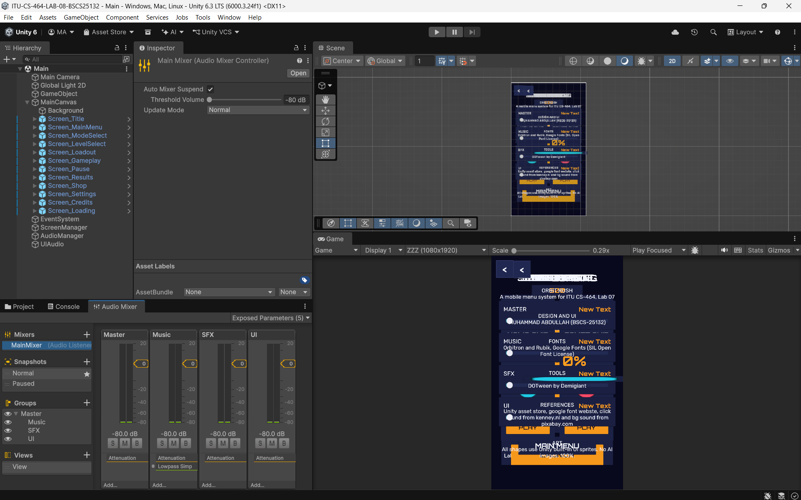

# UNIVERSE FIGHTER - Lab 08

ITU CS-464 Game Development

**Name:** MUHAMMAD ABDULLAH
**Roll number:** BSCS-25132 (B)

This project is built on top of my Lab 07 menu project. All 10 Lab 07 screens, their navigation, tweens and mobile layout still work. In Lab 08 I added a loading screen, a small playable game, sounds and music, an Audio Mixer with volume settings, and C# events.

## Gameplay Video Drive Link

[Watch Gameplay Demo Video](https://drive.google.com/file/d/1l_U5wJAf6j1DdF6plQKqnB41kGVXc0nU/view?usp=sharing)

## Unity version and setup

- Unity 6.3 LTS (6000.3.24f1)

1. Clone this repository and open it in Unity Hub.
2. Open the scene `Assets/_Project/Scenes/Main.unity`.
3. In File > Build Profiles > Scene List, `Main` must be first and `Gameplay` second.
4. Set the Game view to portrait (1080 x 1920) and press Play from the `Main` scene.
5. Or you can simple download only window build folder named as: "Universe_Fighter_Build".
6. Then find .exe file name as : "Universe Fighter" , double click it to test and play the game.

## The game

Move the ship left and right (mouse, touch, or A/D keys). Collect coins and avoid red rocks.

- Classic: 6 levels. Levels unlock one by one. Each level is faster and needs more coins.
- Endless: no target. The game gets faster until you lose.
- Time Attack: collect as many coins as you can in 45 seconds.
- Shop: Nova ship is faster, Comet ship has 1 extra life, Shield blocks one hit, Boost doubles the coins of the next run.

## Loading flow

1. Pressing LAUNCH opens the Loading screen.
2. `SceneLoader` loads the `Gameplay` scene with `LoadSceneAsync` (additive) and sets `allowSceneActivation = false`.
3. The bar and percentage show the real progress (`progress / 0.9`). A minimum show time of 1.5 seconds keeps the bar visible on fast loads.
4. At 100% the scene is activated, the Gameplay screen opens, and only then the game starts.
5. The player cannot play before loading is complete.

## Audio Mixer



| Mixer group | What uses it |
|---|---|
| Master | Parent of all groups |
| Music | The two music AudioSources on `AudioManager` |
| SFX | Gameplay sounds (AudioSource on `GameAudio`) |
| UI | All UI sounds (AudioSource on `UIAudio`) |

Exposed parameters: `MasterVol`, `MusicVol`, `SFXVol`, `UIVol`, `MusicCutoff`.

## Volume settings

- The Settings screen has sliders for Master, Music, SFX and UI.
- Slider value (0 to 1) is changed to decibels with `dB = 20 * log10(value)`.
- At 0 the value is set to -80 dB (silent), so mute is safe.
- Values are saved with PlayerPrefs and loaded when the game starts.

## Sounds and music

- **UI sounds:** one `UIAudio` object plays all of them (hover, click, back, panel open/close, pause, resume, success, error). No AudioSource on each button.
- **Gameplay sounds:** pickup, damage, win and lose, played with `PlayOneShot`. Pickup and damage use a small random pitch change.
- **Music change:** `AudioManager` crossfades two music sources in 1.2 seconds. Menu, Loading and Results use the menu music. Gameplay and Pause use the gameplay music.
- **While paused:** music keeps playing but sounds muffled (low-pass filter 22000 Hz to 700 Hz on the Music group). UI sounds keep playing. Gameplay sounds stop because the game is frozen.

## C# events

`GameManager` publishes these events: `GameStarted`, `Collected`, `Damaged`, `ShieldBlocked`, `Ticked`, `GameWon`, `GameLost`.

| Subscriber | Events | What it does |
|---|---|---|
| `HudListener` | all | Updates score, lives, timer and banner |
| `GameAudioListener` | Collected, Damaged, ShieldBlocked, GameWon, GameLost | Plays sounds |
| `HitFlashListener` | GameStarted, Damaged | Red screen flash |
| `ScreenShakeListener` | Damaged, GameLost | Shakes the play area |
| `ResultsListener` | GameWon, GameLost | Opens the Results screen |
| `Spawner` | GameStarted | Clears old items |

Code excerpt:

```csharp
// GameManager.cs (publisher)
public event Action<int> Damaged;

public void TakeDamage()
{
    Health--;
    Damaged?.Invoke(Health);
}

// HitFlashListener.cs (subscriber)
private void OnEnable()
{
    gm = GameManager.Instance;
    gm.Damaged += OnDamaged;
}

private void OnDisable()
{
    gm.Damaged -= OnDamaged;
}
```

## Credits

| File | What | Author and source | Licence |
|---|---|---|---|
| click1 | UI click | UI Audio pack by Kenney, kenney.nl | CC0 1.0 |
| Space Ambient | Menu music | solarFLEX, pixabay.com | Pixabay Content License |
| Gameplay Music | Gameplay music | pixabay.com | Pixabay Content License |
| Coin Pickup | Coin pickup | RibhavAgrawal, pixabay.com | Pixabay Content License |
| Hit Damage | Damage | DRAGON-STUDIO, pixabay.com | Pixabay Content License |
| Win | Win | u_shmomr78jv, pixabay.com | Pixabay Content License |
| Lose | Lose | u_8g40a9z0la, pixabay.com | Pixabay Content License |
| Shield Broken Sound | Shield Broken | freesound_community, pixabay.com | Pixabay Content License |

Other: Unity, TextMeshPro, DOTween by Demigiant. Fonts: Orbitron and Rubik (Google Fonts). No commercial game audio and no AI images were used.