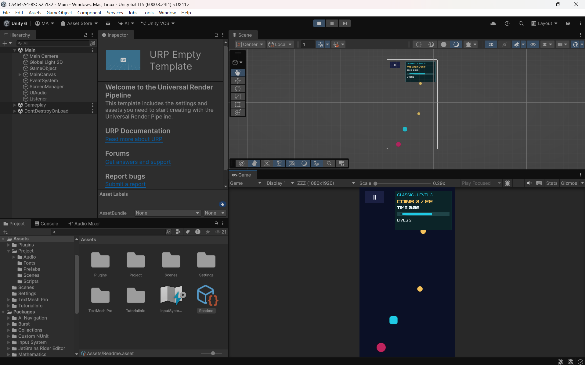

# UNIVERSE FIGHTER - ASM 04

ITU CS-464 Game Development

**Name:** MUHAMMAD ABDULLAH
**Roll number:** BSCS-25132 (B)

## Unity version and setup

- Unity 6.3 LTS (6000.3.24f1)

1. Clone this repository and open it in Unity Hub.
2. Open the scene `Assets/_Project/Scenes/Main.unity`.
3. In File > Build Profiles > Scene List, `Main` must be first and `Gameplay` second.
4. Set the Game view to portrait (1080 x 1920) and press Play from the `Main` scene.
5. Or you can simple download only window build folder named as: "ASM-04-Build-Windows".
6. Then find .exe file name as : "Universe Fighter" , double click it to test and play the game.

## Gameplay Video Drive Link

[Watch Gameplay Demo Video](https://drive.google.com/file/d/17cSnu2fjjBNxVZlPsCZZxAQzDExPbHdC/view?usp=sharing)

## Screenshots

## Settings and Implementation

| Part | Setting | Value | Explanation |
|---|---|---|---|
| A | Colour harmony | Split-complementary, 188° | I used cyan as the main colour. Rose is used for hazards and amber for pickups, so rewards and danger are easy to identify. |
| A | Main colours | #0D272B, #22D3EE, #EDFDFF | These are the dark, middle and light shades. They also look different in grayscale. |
| A | Accent colours | #FFCA61, #C72862 | Amber is used for coins and rose for hazards. The player, coins and asteroids also have different shapes and colours. |
| A | HUD text contrast | 10.34:1, 14.97:1, 8.66:1 | Score, time, lives and mode text have good contrast against the dark panel. All are above the 4.5:1 requirement. |
| A | Button text contrast | 10.41:1, 9.16:1, 14.91:1, 5.83:1 | I used dark text on bright buttons and light text on dark buttons to make labels easy to read. |
| A | Health bar lag | 0.4 sec wait, 0.8 per second | The light part of the health bar shows the health that was recently lost. |
| B | Music and SFX volume | 0 dB and -1.9 dB | Music slider starts at 1 and SFX at 0.8. |
| B | Volume slider values | 1, 0.5, 0.0001 | These give 0 dB, -6.02 dB and -80 dB. The minimum value avoids taking the log of zero. |
| B | SFX pitch | ±2 semitones | Pitch changes between approximately 0.89x and 1.12x. There are four SFX voices and two UI voices using `PlayOneShot`. |
| C | Asteroid sound | Linear, Min 1, Max 5 | The asteroid sound gets quieter with distance and becomes silent at the maximum distance. |
| C | Coin sound | Logarithmic, Min 0.8, Max 12 | This makes the coin sound fade more naturally. The sound can be heard from a longer distance. |
| C | AudioListener | On the player ship | I removed the camera's AudioListener and placed it on the ship so sound distance is measured correctly. |
| D | Unlocked levels | Integer, default 1 | Level 1 is always unlocked when the game starts for the first time. |
| D | Best times | Float, HasKey check | I check if a best time exists before reading it. This avoids showing 0:00 for a level that has not been completed. |
| D | MusicVolume | Float, default 1 | Music starts at full volume on the first run. |

## Assignment Questions

### 1. What happens when `Time.timeScale = 0`?

When `Time.timeScale` is set to 0, all things using `Time.deltaTime` stop moving. In my game, this includes the ship, asteroid spawner, coins, asteroids, game timer and health bar lag.

Some things still work because they use unscaled time. These include menu tweens (`SetUpdate(true)`), the music low-pass fade, `WaitForSecondsRealtime` and audio. The `Update()` method also keeps running, so the Escape key can still be detected.

### 2. What survives when a scene is loaded?

In my game, the `Main` scene stays loaded while the `Gameplay` scene is loaded on top of it. When the game restarts, only the Gameplay scene is loaded again.

`AudioManager` and `SfxPlayer` stay active because they use `DontDestroyOnLoad`. Static data like `GameState`, `RunResult` and `GameplayFlow.IsPaused` also remains available. `PlayerPrefs` data is saved on the device and stays there even after closing the game.

### 3. Why do I use default values with PlayerPrefs?

When a PlayerPrefs key does not exist, Unity returns 0 if no default value is given.

This can cause problems on the first run. For example, no level might be unlocked, music could be silent and the best time could incorrectly show 0:00.

To avoid this, I use default values. The unlocked level starts at 1, music volume starts at 1, and best times are checked using `HasKey`. If there is no saved time, the game shows NOT CLEARED.

### 4. What happens if an event is not unsubscribed?

If a script subscribes to an event using `+=` but does not unsubscribe using `-=`, the event can still hold a reference to that script after it is destroyed.

For example, if `HitFlashListener` is destroyed and the `Damaged` event is called later, Unity can throw a `MissingReferenceException`.

I avoid this by subscribing in `OnEnable()` and unsubscribing in `OnDisable()`. This makes sure the listener is removed when the Gameplay scene is unloaded.

## Credits

| File | What | Author and source | Licence |
|---|---|---|---|
| click1 | UI click | UI Audio pack by Kenney, kenney.nl | CC0 1.0 |
| Space Ambient | Menu music | solarFLEX, pixabay.com | Pixabay Content License |
| Gameplay Music | Gameplay music | pixabay.com | Pixabay Content License |
| Coin Pickup | Coin pickup | RibhavAgrawal, pixabay.com | Pixabay Content License |
| Hit Damage | Damage | DRAGON-STUDIO, pixabay.com | Pixabay Content License |
| Win | Win | u_shmomr78jv, pixabay.com | Pixabay Content License |
| Lose | Lose | u_8g40a9z0la, pixabay.com | Pixabay Content License |
| Shield Broken Sound | Shield Broken | freesound_community, pixabay.com | Pixabay Content License |

Other: Unity, TextMeshPro, DOTween by Demigiant. Fonts: Orbitron and Rubik (Google Fonts). No commercial game audio and no AI images were used.
